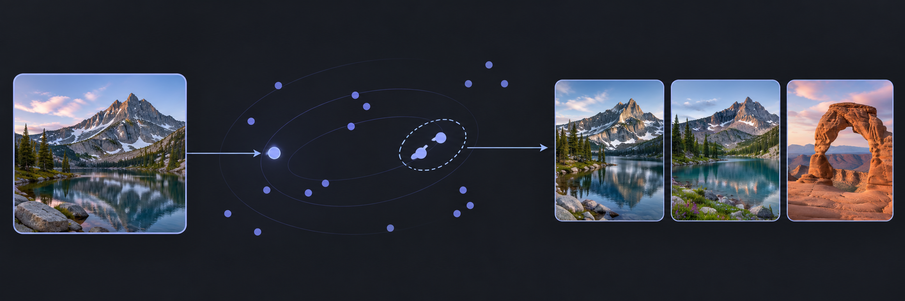
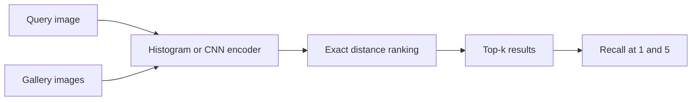

# Image Retrieval from Scratch



**What makes two images similar to a search engine?** This project starts with exact nearest-neighbour search, then will compare colour histograms with learned image embeddings on the same retrieval task.

**Python 3.10+** · **Vector-ranking demo available** · **Image benchmark planned**

[Quick start](#quick-start) · [Experiment design](#experiment-design) · [Repository guide](#repository-guide)

## Quick start

From the repository root, run the standard-library demo.

```sh
python src/baseline.py
```

```text
Nearest image indices: [2, 0]
```

The demo ranks three synthetic feature vectors by Euclidean distance to a query vector and returns the two closest gallery indices. The indices refer to positions in the example list.

## Experiment design

The planned image benchmark will use the same query set, gallery and relevance labels for each feature extractor. Exact search isolates the effect of changing the features.



| Stage | What changes |
| --- | --- |
| First benchmark | Extract normalised colour histograms from a small labelled dataset. |
| Learned features | Replace histograms with CNN embeddings and rerun the same benchmark. |
| Larger gallery | Compare an approximate index with exact search after establishing the baseline. |

Keep query images separate from the gallery, group near-duplicates when splitting training and evaluation data, and document a few failed matches alongside the scores.

## Repository guide

- [Exact nearest-neighbour search](src/baseline.py) — distance-based ranking and synthetic demo.
- [First benchmark](experiments/README.md) — dataset requirements and evaluation protocol.
